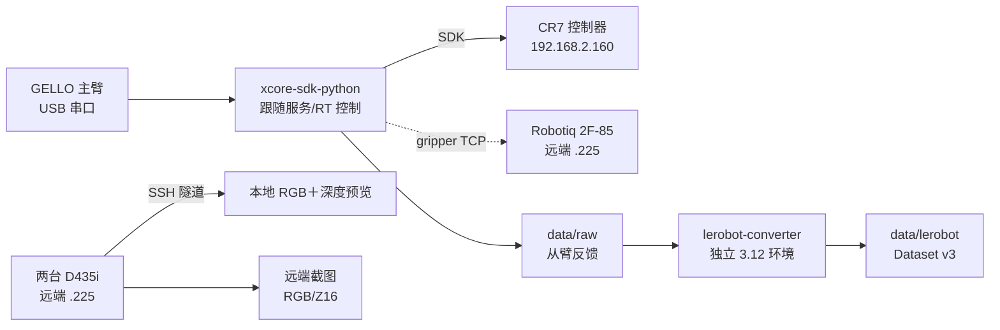

# 架构与数据流

xcore-controller 是一个 `.sh` 编排层：它把 GELLO 主臂、ROKAE xMate CR7、
Robotiq 2F-85 夹爪和远端两台 RealSense D435i 组合成可重复的实验流程。
设备驱动、实时跟随和采集库位于独立 submodule，controller 只决定启动什么、
何时开始/保存/丢弃记录，以及退出时如何清理。



| 运行单元 | 环境 | 资源所有权 |
| --- | --- | --- |
| controller 脚本 | Bash | 进程编排、互斥锁、路径 |
| xcore-sdk-python | Python 3.11 | GELLO 串口、CR7 SDK、raw 记录 |
| xcore-gello-software | Python 3.11 | GELLO 上游代码与只读检查 |
| xcore-gripper-2F85 | Python 3.11 | 夹爪 TCP 服务和 RS485 串口 |
| lerobot-converter | Python 3.12 | 只读 raw，写 LeRobot 数据集 |
| camera-realsense-d435i | 本地 3.11 客户端；远端 3.13 服务 | 相机与 HTTP API |

## 跟随生命周期

`scripts/start_gello_follow.sh` 调用 SDK 的统一入口：

1. 检查夹爪服务、SDK、GELLO 串口和现场标定；只读模式在此停止。
2. 现场确认后启动独立 SDK 跟随服务，读取主臂并计算六个关节目标。
3. 启动对齐要求主臂保持不动；起始姿态和目标都必须通过限位检查。
4. 实时跟随按软件限速（默认 75 °/s、40 °/s²）发送目标，夹爪目标单独传递。
5. Ctrl+C、故障或实验结束：停止 RT，关闭会话，然后返回保存姿态。

裸命令不授权运动；只有 `--enable-motion` 才进入真实跟随。旧的跟随会话完全退出前
不能启动第二个会话；`.follow.lock` 是应用锁，不要删除锁文件绕过。

## 数据流

`scripts/start_data_record.sh` 在跟随之上启用 raw 记录：

```text
data/raw/session_<时间>/manifest.json
data/raw/session_<时间>/episodes/episode_000000.jsonl
```

- R 开始、S 保存、D 丢弃、P 状态、H 帮助。
- 记录的是从臂实际反馈，不是目标角。
- 未保存片段保留 `.jsonl.partial`，转换器忽略。
- 退出返回和故障恢复不写入 episode。
- 保存后由 `lerobot-converter` 的 3.12 环境转换成 LeRobot Dataset v3；
  数据集 FPS 与控制频率是两个独立阶段。

## 相机

两台相机分别运行独立进程，各自绑定序列号和端口，HTTP 只监听远端 loopback。
本地通过 SSH 转发访问；关闭网页不会停止采集。详见[相机](cameras.md)。

## 子项目文档

| 项目 | 文档 |
| --- | --- |
| SDK | [README](../xcore-sdk-python/README.md) / [docs](../xcore-sdk-python/docs/index.md) |
| GELLO | [README](../xcore-gello-software/README.md) / [docs](../xcore-gello-software/docs/index.md) |
| 夹爪 | [README](../xcore-gripper-2F85/README.md) / [docs](../xcore-gripper-2F85/docs/index.md) |
| 转换器 | [README](../lerobot-converter/README.md) / [docs](../lerobot-converter/docs/index.md) |
| 相机 | [README](../camera-realsense-d435i/README.md) / [docs](../camera-realsense-d435i/docs/index.md) |

所有项目的默认参数和覆盖方式见[配置](reference/config.md)与
[子模块配置](reference/submodule-config.md)。
